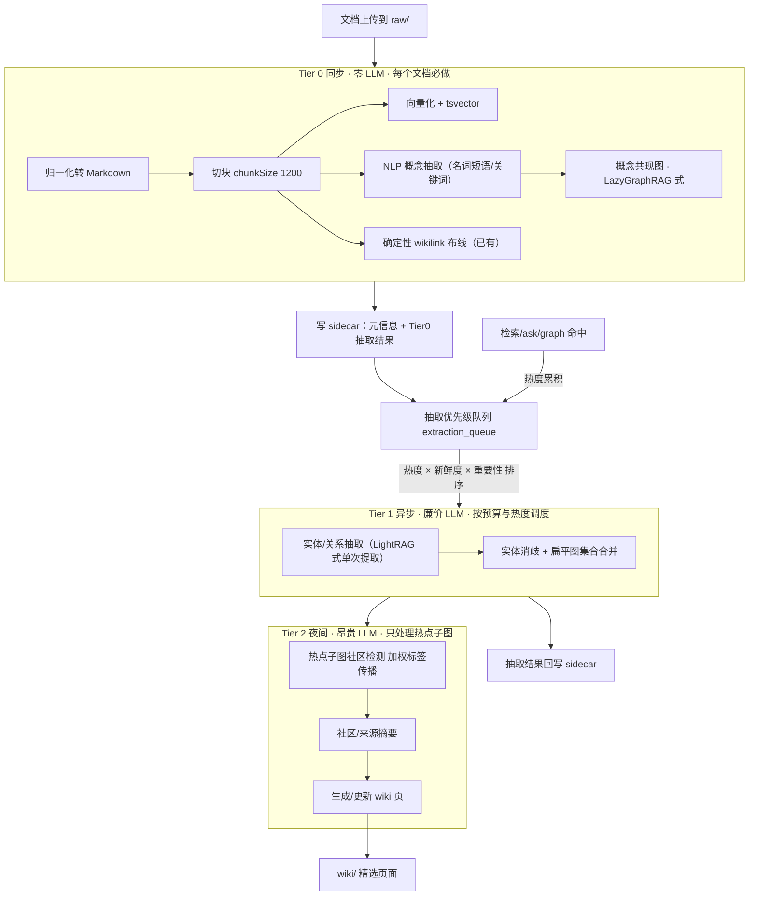
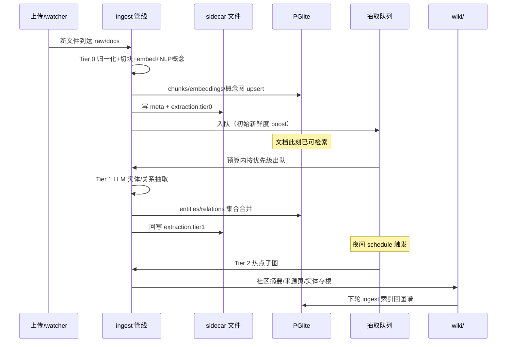

# 01 — 文档处理系统：面向海量文本的 Graph Wiki 方案

> 文档上传后的处理管线设计：切块、实体/关系抽取、sidecar 元信息与热度追踪、
> 目录层次。目标规模：十万至百万级文档。
>
> 状态：**核心已实现**（prepare 层 + sidecar：`src/ingest/prepare.ts`、`src/ingest/source.ts`、`src/fs/sidecar.ts`；
> Tier 0 概念图：`src/graph/concepts.ts`；Tier 1 队列：`src/graph/tier1.ts`；
> Tier 2 精炼：`src/wiki/refine.ts`；热度：`src/stats/heat.ts`）。
> 本文保留原始设计动机与规模化路线，供理解取舍。
> **v2 更新**：ingest 已改为 `sync`（声明态 vs 运行态对账），图写入全部经
> lineage 运行时（scope / evidence / fold），wiki 页面成为带依赖声明的视图；
> 本文中关于 `clearDocumentGraph`、`upsertRelation` 权重累加、生成页反哺图谱
> 的描述已被 [05 — Agent Context Database](05-agent-context-db.zh-CN.md) 取代。
> **v3 布局（2026-09-13）**：`cooked/` 已取消。文档键就是 raw 路径；文本源不再落盘
> 副本（索引时在内存中归一化）；PDF/图片的转换结果与 meta / tier0 / tier1 / usage /
> 摘要缓存拆成独立文件，放在镜像整个数据目录的 `.sidecar/<key>/` 下；被删源的整个
> sidecar 目录进入 `ledger/attic/<scopeId>/`；`packs/`、`capabilities/`、`intents/`
> 合并为 `playbooks/`。本文 §3–§4 里的 `cooked/docs/<name>.md.knode.json` 描述的是 v2 布局。

## 0. 背景与目标

设计前的摄入管线（旧版 `src/ingest/pipeline.ts`）是单层的：

```
scan → sha256 diff → chunk → embed → tsvector → wikilink 布线 → [可选] LLM 全量抽取
```

它对个人知识库（千级文档）够用，但有三个结构性问题（均已由本设计解决）：

1. **LLM 抽取与摄入耦合**：旧版在 ingest 同步路径上对每个
   `raw/docs` 文档做一次全文抽取。文档量到十万级时，成本和时延都不可接受，
   且没有预算控制、没有优先级。
2. **抽取结果只存在于 DB**：`.knode/` 被定义为"可随时删除重建"，但重建意味着
   重新支付全部 LLM 抽取成本——在海量场景下这个"可弃"承诺实际上失效了。
3. **没有使用反馈回路**：文档/块被检索命中多少次、何时被用过，系统完全不知道，
   wiki 生成和抽取投入无法向"真正被用的知识"倾斜。

本设计的目标：

- 每个文档上传后**立即可检索**（秒级，零 LLM）；
- LLM 成本**按热度分层投放**，有全局预算约束；
- 抽取结果**持久化在文件层（sidecar）**，DB 重建不重付 LLM 成本；
- 使用统计（时间、热度）沉淀到 sidecar 并**反映到 wiki**；
- 存储与图算法为十万–百万级预留扩展路径。

## 1. 项目调研与对比

### 1.1 各项目速览

| 项目 | 索引期做什么 | 查询期做什么 | 增量更新 |
| --- | --- | --- | --- |
| **Microsoft GraphRAG（标准版）** | LLM 逐 chunk 抽实体/关系/claim → 合并 → Leiden 层级社区检测 → LLM 生成社区摘要 → 全量 embedding | local search（实体邻域）/ global search（逐层 map-reduce 社区摘要）/ DRIFT | 困难，官方仍在完善增量逻辑，常需重跑管线 |
| **FastGraphRAG（GraphRAG 内置模式）** | 用传统 NLP 替代 LLM 做实体/关系抽取（`extract_graph_nlp` + `prune_graph`），社区报告改为基于文本；不抽 claim | 同标准版 | 同标准版 |
| **LazyGraphRAG** | 只做 NLP 名词短语提取 + 概念**共现图** + 图统计社区结构，**零 LLM** | 查询分解为子查询 → 向量排 chunk → 按社区迭代加深 + LLM 逐句相关性测试（预算可调）→ map-reduce 出答案 | 天然容易（索引轻量） |
| **LightRAG** | LLM 对每个 chunk 单次提取多粒度实体/关系（低层实体 + 高层关键词），构成**扁平图**，无社区、无摘要 | dual-level 检索：低层实体匹配 + 高层主题匹配，图邻域扩展 | **原生支持**：新文档抽取后集合并入全局图；删除可复用抽取缓存 |
| **llm_wiki（v2）** | LLM 增量维护一个持久 wiki：sources/entities/concepts 页面 + `purpose.md`/`schema.md`/`index.md`/`log.md` 锚点；图谱从 `[[wikilink]]` 派生 | 混合检索 + 图扩展；wiki 页本身就是可读产物 | 逐文档增量，wiki 页面持续演化 |
| **gbrain** | Markdown 为事实源，PGlite 为**可丢弃派生索引**；每次写入做零 LLM 确定性图布线；夜间 dream cycle 做昂贵整理 | 混合检索 | 逐文件 sha 增量 |

### 1.2 成本 / 效率 / 准确性对比

以约 500 页语料、GPT-4 级模型定价为参照（数据来自各项目公开基准，量级供决策用）：

| 维度 | 标准 GraphRAG | FastGraphRAG | LightRAG | LazyGraphRAG | 纯向量 RAG |
| --- | --- | --- | --- | --- | --- |
| 索引成本 | $50–200（抽取占 58–75% token） | 约标准版 25% | 约标准版 1%（~$0.50） | 约标准版 0.1%，≈ 向量 RAG | < $5 |
| 索引耗时 | ~45 分钟 | 明显更快（无 LLM 抽取） | ~3 分钟 | ≈ 向量 RAG | 分钟级 |
| 全局综合类查询 | 最强（企业基准 86% vs 向量 32%；综合性 +26%、多样性 +57%） | 下降（NLP 抽取精度低） | 70–90% 标准版水平 | 与标准版相当甚至更优（官方基准） | 差 |
| 局部事实类查询 | 好 | 好 | 好 | 好（先走向量，够用即停） | 好 |
| 查询成本/时延 | global search 昂贵（多轮社区摘要 map-reduce） | 同左 | 低（无社区遍历） | 中（LLM 相关性测试计入查询期，预算可调） | 最低 |
| 增量友好度 | 差 | 差 | **好** | 好 | 好 |
| 百万级可行性 | 不可行（$33K/次重建的量级案例） | 勉强 | 可行 | **可行** | 可行 |

### 1.3 结论：各取一件事

- 取 **LazyGraphRAG** 的"索引期零 LLM"：NLP 概念 + 共现图作为每个文档的保底图谱信号，索引成本压到与向量 RAG 同级——这是支撑百万级的前提。
- 取 **LightRAG** 的扁平图 + 集合合并：LLM 抽取结果直接并入全局 `entities`/`relations`，不依赖全图社区重建，增量天然成立。knode-os 现有的 schema（扁平 entities/relations 表）与此吻合，不需要推倒。
- 取 **gbrain** 的"文件为真、索引可弃"，并补上它缺的一块：**LLM 抽取结果也要落文件**（sidecar），否则"可弃"承诺在海量场景失效。
- 取 **llm_wiki** 的"wiki 是最终产品"：sources/entities/concepts 页面持续演化，图谱与 wiki 互相喂养。社区摘要（GraphRAG 最贵也最有价值的部分）不做全图版，只对**热点子图**做，产出直接写成 wiki 页。

一句话：**海量方案 = Lazy 的索引 + Light 的图 + gbrain 的文件观 + llm_wiki 的产品形态，用热度决定 LLM 花在哪**。

## 2. 分层抽取管线

核心原则：**LLM 成本按热度分层投放，而不是对每个文档一视同仁**。
百万文档中绝大多数永远不会被查询命中，为它们支付 LLM 抽取费用是纯浪费；
反过来，被反复命中的文档值得最贵的处理（高质量抽取、社区摘要、wiki 策展）。

### 2.1 三层管线总览



### 2.2 Tier 0 — 同步基础索引（零 LLM，秒级）

上传即执行，完成后文档立即可被三路检索（vector / keyword / graph）命中：

1. **归一化**：转成规范 Markdown 写入 `cooked/`（见第 4 章）。文本直接复制；
   PDF 优先本地提取文本，无文本页及图片通过独立视觉模型路由转换。
2. **切块**：沿用 `src/ingest/chunker.ts`（LangChain
   `RecursiveCharacterTextSplitter`，markdown 感知，1200/150）。sidecar 中记录
   每个 chunk 的 `id/seq/offset`，使 chunk 可从 cooked 文件 + sidecar 完整重建。
3. **向量 + 全文**：沿用现有 embeddings + tsvector 流程。
4. **NLP 概念抽取（新增）**：从每个 chunk 提取名词短语/关键词（英文可用
   POS-tag 名词短语；CJK 用分词 + 停用词过滤 + TF-IDF 截断）。产出
   `concept` 类型的轻量实体 + chunk 级 `co_occurs` 边（LazyGraphRAG 的概念共现
   图）。这层图谱质量不高，但覆盖 100% 文档、成本为零，保证冷文档也有图信号。
5. **确定性 wikilink 布线**：沿用 `src/graph/extract.ts` 的 `wireFromMarkdown`。

实现上，Tier 0 = 现有 `ingestAll`/增量 ingest 减去 `extractWithLlm`，加上
NLP 概念抽取与 sidecar 写入。

### 2.3 Tier 1 — 异步实体/关系抽取（廉价 LLM，预算调度）

把现在同步路径上的 `extractWithLlm` 挪到后台队列：

- **队列**：新增 `extraction_queue` 表（DB 内，可从 sidecar 状态重建）。Tier 0
  完成后入队；检索命中会提升在队文档的优先级。
- **优先级** = `热度 × 新鲜度 × 重要性`：
  - 热度：第 3 章的指数衰减访问分；
  - 新鲜度：新上传文档有一个初始 boost（衰减若干天），保证新知识不会因为
    还没被查询过而永远排不上；
  - 重要性：可配的静态权重（如 `raw/docs` > `raw/skills`；未来可按目录/
    frontmatter 标记）。
- **预算**：`extraction.dailyTokenBudget` 约束每日 LLM 用量。预算耗尽即停，
  明天从队首继续。百万级语料下这意味着图谱按"被用的顺序"渐进变密，而不是
  一次性付清。
- **抽取本身**：沿用现有 prompt 结构（10 实体类型 / 8 关系类型），按 LightRAG
  方式对 chunk 批量单次提取，结果做名称/别名消歧后**集合并入**全局
  `entities`/`relations`（现有 upsert 逻辑已是合并语义，`mention_count`、
  `co_occurs` weight 累积保留）。
- **回写 sidecar**：抽取结果连同 `model`、`contentSha` 写入 sidecar 的
  `extraction.tier1`。下次 DB 重建或内容未变的重复 ingest，直接从 sidecar
  回放，不再调 LLM。

### 2.4 Tier 2 — 夜间热点精炼（昂贵 LLM，只做热点）

复用 dream 调度器模式（`src/dream/dream.ts` 的 `startDreamScheduler`），
每晚在 `dream.schedule` 附近运行：

1. **选择热点子图**：按实体的加权 mention（用命中 chunk 的热度加权）取
   top-K 实体，诱导出子图。**不做全图 Leiden**——百万级实体的全图社区检测
   既贵又没必要，冷区图谱留在 Tier 0/1 质量即可。
2. **社区检测 + 摘要**：对热点子图做社区检测（实现采用加权标签传播——对
   top-K 诱导子图而言 Leiden 属于过度设计），对每个社区用 LLM 生成摘要——
   这就是 GraphRAG 全局查询能力的来源，但只花在被使用的知识上。
3. **写 wiki**：
   - 社区摘要 → `wiki/concepts/<topic>.md`（新建或更新，追加变更到 `log.md`）；
   - 热点文档 → `wiki/sources/<slug>.md` 摘要页（沿用 `generateSourcePage`）；
   - 高 mention 实体 → `wiki/entities/` 存根（沿用 `generateEntityStubs`）；
   - `wiki/index.md` 维护"热点主题"区块（见 3.3）。
4. wiki 页被下一轮 ingest 索引回图谱——保留现有 wiki ↔ graph 正反馈循环。

### 2.5 单文档时序



## 3. Sidecar：元信息、抽取结果与热度

### 3.1 定位与格式

每个源一个 sidecar 目录（v3）：`raw/docs/<name>.md` →
`.sidecar/raw/docs/<name>.md/{meta,tier0,tier1,usage}.json`，PDF/图片另有 `content.md`，
LLM 摘要缓存在 `views/`；每个文件由各自的写入方独立 tmp+rename。v2 时期是单个
`cooked/docs/<name>.md.knode.json`，下文 3.2 的 JSON 结构仍按 v2 记录。

它是 gbrain "文件为真"哲学的延伸：**凡是重建成本高的派生物（LLM 抽取结果、
使用统计）都必须落在文件层**；`.knode/` DB 里只放重建成本低的东西（embedding
可重算、tsvector 可重建、图谱可从全体 sidecar 回放）。删除 `.knode/` 后
`ingest` 重建索引时：

- Tier 0 部分照常重算（廉价）；
- Tier 1 部分若 sidecar 中 `contentSha` 与当前内容一致，直接回放入库，
  **零 LLM 成本**；
- 使用统计从 sidecar 恢复，热度不丢。

### 3.2 JSON 结构

```json
{
  "version": 1,
  "meta": {
    "sha256": "…",
    "title": "…",
    "sourceType": "md | pdf | html | txt",
    "rawPath": "raw/docs/foo.pdf",
    "ingestedAt": "2026-07-05T05:00:00Z",
    "chunks": [
      { "id": "a1b2…", "seq": 0, "offset": [0, 1180], "tokenCount": 300 }
    ]
  },
  "extraction": {
    "tier0": {
      "concepts": ["postgres", "向量索引"],
      "wikilinks": ["pgvector"],
      "extractedAt": "…"
    },
    "tier1": {
      "status": "pending | done | failed",
      "entities": [
        { "name": "PGlite", "type": "technology", "description": "…", "aliases": ["pglite"], "chunkIds": ["a1b2…"] }
      ],
      "relations": [
        { "source": "PGlite", "target": "pgvector", "type": "uses", "weight": 1.0 }
      ],
      "model": "gpt-4o-mini",
      "contentSha": "…",
      "extractedAt": "…"
    }
  },
  "usage": {
    "firstSeenAt": "…",
    "lastAccessedAt": "…",
    "accessCount": 42,
    "heat": 0.83,
    "chunkHits": {
      "a1b2…": { "count": 7, "lastAt": "…" }
    },
    "flushedAt": "…"
  }
}
```

约定：

- sidecar 由系统独占写入，用户不应手改（校验 `meta.sha256` 不符时以 cooked
  文件为准重算）；
- 写入采用临时文件 + rename，避免半写状态；
- `extraction.tier1.contentSha` 是抽取时的内容哈希，是"能否回放"的唯一判据。

### 3.3 热度机制

**记账（热路径，只写 DB）**：`search`/`ask`/`graph` 命中 chunk 时，向新表
`chunk_stats` 记一笔。热路径绝不写 sidecar 文件（避免检索延迟与写放大）。

```sql
CREATE TABLE IF NOT EXISTS chunk_stats (
  chunk_id    TEXT PRIMARY KEY REFERENCES chunks(id) ON DELETE CASCADE,
  hit_count   INTEGER NOT NULL DEFAULT 0,
  last_hit_at TIMESTAMPTZ
);

CREATE TABLE IF NOT EXISTS doc_stats (
  document_id  TEXT PRIMARY KEY REFERENCES documents(id) ON DELETE CASCADE,
  hit_count    INTEGER NOT NULL DEFAULT 0,
  last_hit_at  TIMESTAMPTZ,
  heat         REAL NOT NULL DEFAULT 0,   -- 指数衰减分，定期重算
  heat_updated TIMESTAMPTZ
);

CREATE TABLE IF NOT EXISTS extraction_queue (
  document_id TEXT PRIMARY KEY REFERENCES documents(id) ON DELETE CASCADE,
  tier        INTEGER NOT NULL DEFAULT 1,
  priority    REAL NOT NULL DEFAULT 0,    -- 热度×新鲜度×重要性，定期重算
  enqueued_at TIMESTAMPTZ NOT NULL DEFAULT now(),
  attempts    INTEGER NOT NULL DEFAULT 0
);
```

**热度分**：指数时间衰减的访问计数，半衰期可配（默认 14 天）：

```
heat_new = heat_old * 0.5^(Δt / halfLife) + hits_since_last_update
```

**回刷（冷路径）**：后台任务每小时把 `chunk_stats`/`doc_stats` 聚合回刷到对应
sidecar 的 `usage` 字段。DB 与 sidecar 之间，DB 是实时账本、sidecar 是持久
快照，重建时以 sidecar 为底、之后 DB 继续累加。

**热度的三个用途**：

1. **检索排序**：RRF 融合后按 `1 + α·heat` 微调（α 默认 0.1，可配；避免热度
   垄断，只做 tie-break 级别的提升）。
2. **抽取调度**：Tier 1 队列优先级、Tier 2 热点子图选择（见第 2 章）。
3. **wiki 呈现**：
   - `wiki/sources/<slug>.md` frontmatter 写入 `heat`/`lastAccessedAt`，页面
     顶部渲染热度徽标；
   - `wiki/index.md` 由 Tier 2 维护"热点主题"区块（top-N 热点社区/实体链接）；
   - 冷文档（heat 低于阈值且超期未访问）在 wiki 生成时降级为 sources 索引页中
     的一行链接，不再单独维护摘要页。

## 4. 目录层次

### 4.1 结论：raw 与 wiki 之间加一层，共 4 层 + 1 个派生索引

```
<data>/
├── knode.config.json
├── purpose.md  schema.md
├── raw/                 # L0 原始层：上传原件（含 PDF 等二进制），只读不改；raw 路径 = 文档键
│   ├── docs/  traces/{claude,codex}/  skills/
├── .sidecar/            # L1 派生层（v3）：镜像整个数据目录，每个源一个目录（系统管理，需保留）
│   └── raw/docs/foo.pdf/
│       ├── content.md           # 仅 PDF/图片/episode：转换出的 Markdown；文本源不落盘副本
│       ├── meta.json            # sourceSha256 / contentSha256 / normalizer / conversion / chunks
│       ├── tier0.json  tier1.json  usage.json
│       └── views/source-summary.md
├── wiki/                # L3 精炼层：策展的知识产品（现有结构不变）
│   ├── index.md  log.md  overview.md
│   ├── entities/  concepts/  sources/  dreams/
├── playbooks/           # packs/ capabilities/ intents/：agent 可编辑的配置
├── ledger/              # events.jsonl + attic/<scopeId>/（被删源的整个 sidecar 目录）
└── .knode/              # L2 派生索引：PGlite（chunks/embeddings/graph/stats）
    └── db/                       随时可删，从 raw + .sidecar 重建
```

> v2 时期这一层叫 `cooked/docs/`，文本文件也复制一份、sidecar 是单个 `<name>.md.knode.json`；
> 下文 4.2–4.4 的论证与迁移步骤保留为历史记录。

四个层次的职责与可弃性：

| 层 | 内容 | 谁写 | 可弃性 |
| --- | --- | --- | --- |
| L0 `raw/` | 用户原件，字节不动 | 用户/trace sync | **不可弃**，唯一事实源 |
| L1 `cooked/` | 归一化 Markdown + sidecar | 系统 | 文本部分可从 raw 重算；sidecar 的 tier1/usage **重建昂贵**，视为半持久 |
| L2 `.knode/` | DB 索引 | 系统 | 完全可弃，从 L1 重建（有 sidecar 后重建不再需要 LLM） |
| L3 `wiki/` | 人读的精炼知识 | 系统生成 + 用户编辑 | **不可弃**，是产品本身 |

### 4.2 为什么是这一层，而不是更多层

- **归一化层（L1）解决两个实际问题**：
  1. PDF/图片/扫描件的转换产物需要一个落脚点，而 raw 必须保持原件不可变；
  2. sidecar 不能污染 raw——raw/docs 是用户自己管理的目录，塞满
     `.knode.json` 会破坏"用户文件系统"的体验，也会被 watcher 误触发。
- **不需要"抽取中间层"目录**：GraphRAG 有独立的 parquet 输出层，但那是批处理
  框架的产物。这里抽取中间结果的归宿是 sidecar（文件、可回放）+ DB（可查询），
  再加独立目录只会引入第三份需要同步的状态。
- **不需要"社区/摘要层"目录**：Tier 2 的社区摘要直接写成 wiki 页
  （`concepts/`），它就是给人和 agent 读的最终产物，llm_wiki 的做法。
- **traces/skills 不进 cooked**：它们已是系统同步的规范格式，sidecar 需求弱
  （无 LLM 抽取回放需求时不强制），首期只对 `docs` 启用 L1，保留扩展可能。

### 4.3 对现有代码的影响

- `src/fs/datadir.ts`：`RAW_DIRS` 增加 `cooked/docs`；init 时创建。
- `src/ingest/pipeline.ts`：`ROOTS` 中 `raw/docs` 改为 `cooked/docs`
  （wiki、skills 不变）；新增 raw→cooked 归一化步骤；移除同步
  `extractWithLlm` 调用，改为入队。
- `src/server/serve.ts`：watcher 监听 raw/docs 触发归一化 + Tier 0；新增
  Tier 1 预算循环与 stats 回刷定时任务；Tier 2 挂在 dream 调度器旁。
- `src/store/db.ts`：新增 `chunk_stats`/`doc_stats`/`extraction_queue` 三表。
- `src/search/search.ts`、`src/search/ask.ts`、`src/graph/query.ts`：命中后
  异步记账；RRF 热度微调。
- `src/wiki/generate.ts`：来源页 frontmatter 带热度；index.md 热点区块；
  冷文档降级逻辑。
- `src/config.ts`：新增配置块（见第 5 章）。

### 4.4 迁移步骤（从现状两层到四层）

1. 新建 `cooked/docs/`；对存量 `raw/docs` 逐个生成 cooked 文件（.md 硬链接）
   与 sidecar 骨架（`meta` + 空 `usage`）。
2. 若 DB 中已有 LLM 抽取结果（`entities`/`relations` 带 `document_id`），
   一次性导出回填到对应 sidecar 的 `extraction.tier1`，避免已付成本丢失。
3. 切换 `ROOTS` 指向 `cooked/docs`，`documents.path` 随之迁移（或删 `.knode/`
   全量重建——此时 sidecar 已能回放，重建免 LLM）。
4. 启用 stats 记账与回刷；`extraction_queue` 从"sidecar 无 tier1 的文档"初始化。

## 5. 面向十万–百万级的扩展预留

- **存储抽象**：当前 `src/store/db.ts` 直连 PGlite。定义 `Store` 接口边界
  （documents/chunks/embeddings/graph/stats 五组操作），schema 保持 Postgres
  兼容，十万级以上可切换到独立 Postgres：pgvector 用 HNSW（中小规模）或
  DiskANN（百万向量以上），`chunks_tsv_idx` 等 GIN 索引原样迁移。PGlite 单
  进程、全内存 WASM，十万文档（约百万 chunk × 384 维）是它的实际上限区间。
- **图查询**：BFS 保持 3–4 hop 上限（现有 hop decay 0.5 不变）；`relations`
  按 `source_id`/`target_id` 已有索引；百万级实体时一切社区计算只跑热点诱导
  子图（Tier 2），永不全图 Leiden。
- **抽取预算与并发**：Tier 1 按 batch 出队、并发调用受 `batchSize` 与预算双重
  约束；失败重试计入 `attempts`，超限落 `failed` 并保留在 sidecar 供人工排查。
- **增量与幂等**：沿用 sha256 diff；`contentSha` 使 Tier 1 结果在内容不变时
  永久复用；sidecar 原子写保证崩溃安全。
- **NLP 概念抽取的语言问题**：CJK 名词短语提取质量有限，首期用
  分词 + 停用词 + TF-IDF 即可（检索有向量和 tsvector 兜底，概念图只是第三路
  信号）；后续可换更好的关键词算法而不动架构。

### 5.1 新增配置

```jsonc
{
  "extraction": {
    "dailyTokenBudget": 2000000,   // Tier 1+2 每日 LLM token 预算
    "tier1Model": "",              // 空 = 沿用 llm.model；建议廉价模型
    "tier2Model": "",              // 空 = 沿用 llm.model；建议高能力模型
    "freshnessBoostDays": 3,       // 新文档优先级 boost 衰减期
    "importance": { "docs": 1.0, "skills": 0.6 }
  },
  "heat": {
    "halfLifeDays": 14,            // 热度半衰期
    "flushIntervalMinutes": 60,    // stats 回刷 sidecar 周期
    "searchWeight": 0.1,           // RRF 热度微调系数 α
    "coldThreshold": 0.05          // 低于此热度视为冷文档（wiki 降级）
  }
}
```

## 6. Claims：可引用的事实断言层

概念对齐：**concepts**（LazyGraphRAG 名词短语共现）在 Tier 0 已实现；**claims**
（GraphRAG 的 covariate，时间边界的事实断言）与 **facts**（OpenIE 式原子事实）
合并为一张 `claims` 表——fact 就是 `status = 'fact'` 的 claim。

claims 与 relations 的分工：relation 是图的**结构边**（BFS 扩展、社区检测用），
claim 是**可引用的陈述**（subject + object + 状态 + 起止日期 + 原文 grounding），
用于问答证据、矛盾检测和知识过期提醒。互补不冗余。

### 6.1 抽取

GraphRAG 把 claim 抽取做成独立 workflow（额外一轮 LLM，默认关闭）。这里合并进
**Tier 1 的同一次抽取调用**：prompt 同时返回 entities/relations/claims（最多
10 条），成本只增加输出 token（约 +30%），不增加调用次数；`extraction.claims`
配置可关闭。约束：subject 必须是本次抽出的实体之一（解析失败即丢弃）、object
可为空、日期未知留空、statement 用文档原语言。

落库时按 statement 与 chunk 的词重叠做 grounding（`claims.chunk_id`）；claim
随 entities/relations 一起写入 sidecar `extraction.tier1.claims`，享受同样的
`contentSha` 回放——删库重建零 LLM。重摄入时按 `document_id` 清除旧 claims。

### 6.2 使用

1. **ask 问答**：检索出 contexts 后，经 `entity_mentions` 取命中实体的 claims
   （限 8 条），作为 `# Known facts` 结构化证据块注入 prompt；`suspected` /
   `disputed` 状态要求答案中显式标注不确定性。
2. **图查询**：`graphSearch` 对 top 实体附带 claims 返回，Web UI 实体卡片展示。
3. **实体 wiki 页**：`generateEntityStubs` 生成存根时追加 `## Facts` 区块
   （断言 + 状态徽标 + 时效）。
4. **夜间审计**（Tier 2 内，零 LLM 启发式）：同 subject + 同 type 的 claims 中
   状态冲突（fact vs disputed）或跨文档高词重叠的相似断言 → `suggestions` 表
   （kind `knowledge`）走人工审阅；`end_date` 已过期的 fact 同样提醒。

## 7. 与旧版（设计前）的差异总结

下表"旧版"指本设计落地前的单层管线；"本设计"列即当前实现。

| 方面 | 旧版 | 本设计（已实现） |
| --- | --- | --- |
| LLM 抽取时机 | ingest 同步路径，逐文档全付 | 异步队列，预算 + 热度调度 |
| 抽取结果持久层 | 仅 DB（重建即重付） | sidecar 文件（重建免 LLM） |
| 零 LLM 图信号 | 仅 wikilink | wikilink + NLP 概念共现图（全覆盖） |
| 社区/全局摘要 | 无 | Tier 2 热点子图社区摘要 → wiki 页 |
| 使用统计 | 无 | chunk/doc 级命中 + 热度，进检索排序、调度与 wiki |
| 事实断言 | 无 | claims 表（状态 + 时效 + grounding），进 ask 证据/实体页/矛盾审计 |
| 目录层次 | raw → wiki（2 层 + DB） | raw → cooked(+sidecar) → wiki（4 层 + DB） |
| 规模上限 | 千级（LLM 成本约束） | 十万级（PGlite 内）；百万级（外接 Postgres） |
