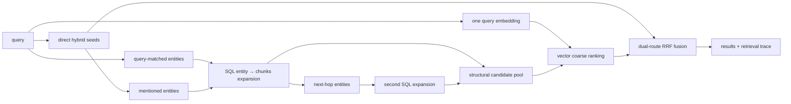

# 04 — SAG 查询时事件检索

本文记录 knode-os 对 [Zleap-AI/SAG](https://github.com/Zleap-AI/SAG) 和其
[论文](https://arxiv.org/abs/2606.15971)中事件—实体检索思想的第一阶段实现。
目标不是再引入一套 Python/Neo4j 服务，而是在现有 PGlite 派生索引上获得
SAG 最有价值的动态多跳召回能力。
（v2 更新：所有查询只走活跃实体 `tx_to IS NULL`，`knode_search --as-of`
可按系统时间回看；见 [05 — Agent Context Database](05-agent-context-db.zh-CN.md)。）

## 与现有 Graph 的分工

| 路线 | 节点/边 | 擅长的问题 | 结果 |
| --- | --- | --- | --- |
| `graph search` | 持久化 `entities + relations` | 已知实体关系、邻域浏览、图谱洞察 | 实体、关系、落地 chunks |
| `hybrid` | embedding、FTS、查询命中实体 | 直接语义/关键词事实查找 | 独立 chunks |
| `sag` | 查询时 `chunks ⇄ entity_mentions ⇄ entities` | 需要跨事件共享参与者才能发现的证据链 | chunks + 桥接路径 |

两套图互补：持久关系图描述“实体之间已抽取出的关系”，SAG 路线描述“哪些
事件因为共享实体而在本次查询中值得继续探索”。后者不向数据库写临时边。

## 第一阶段数据映射

SAG 的最小模型是事件与实体的二部图。本项目当前采用无迁移映射：

```text
SAG event         = chunks.id
SAG entity        = entities.id
SAG event_entity  = entity_mentions(entity_id, chunk_id)
event embedding   = embeddings(chunk_id, embedding)
```

chunk 比理想的原子事件更粗，但已有稳定来源、文本、embedding 与实体落点，
可以先验证动态扩展的收益，并且数据库可随时由 markdown/sidecar 重建。

## 查询流程



1. 用原 hybrid 召回直接证据，并取前 `seedChunks` 个 chunk 作为事件种子。
2. 合并种子中提及的实体和查询文字直接命中的实体。
3. 根据实体稀有度（IDF）、当前前沿支持数和查询命中加分选择实体前沿。
4. 用 SQL 窗口函数限制每个实体最多展开 `maxEventsPerEntity` 个事件。
5. 重复 `maxHops` 轮；默认两轮，可形成 `event → entity → event → entity → event`。
6. 对结构候选池做 pgvector 粗排，再以 RRF 融合结构名次与向量名次。
7. 最终再融合直接路线，并按 `directRatio` 保留直接证据配额。没有实体边时，
   结果自然退化为直接 hybrid，而不是空结果。

查询 embedding 在整条路径中只计算一次。候选扩展留在 PGlite 中完成，不引入
第二数据库或额外服务。

## 可解释性

`SearchResult.trace` 对 SAG 结果提供：

- `route`: `direct | sag | both`
- `hop`: 到达结果所需的扩展轮数
- `seedChunkId`: 结构路径起点
- `bridgeEntities`: 顺序化的桥接实体，例如 `Acme → Alice`

`signals.structural` 保留结构得分，`signals.vector` 保留候选粗排相似度。CLI
使用 `--json`、REST 与 MCP 均能看到完整 trace；网页会在分数旁显示桥接实体。

## 配置与入口

```jsonc
{
  "retrieval": {
    "sag": {
      "seedChunks": 12,
      "entityFrontier": 24,
      "maxEventsPerEntity": 12,
      "candidatePool": 120,
      "maxHops": 2,
      "directRatio": 0.5
    }
  }
}
```

- CLI：`knode-os search "..." --mode sag`、`knode-os ask "..." --mode sag`
- REST：`GET /api/search?...&mode=sag`；`POST /api/ask` body 可传 `mode`
- MCP：`knode_search` / `knode_ask` 的 `mode: "sag"`
- Web：Search 或 Ask 页选择 `SAG multi-hop`
- 评测：`knode-os bench retrieval --modes hybrid,sag`

默认仍为 hybrid。这允许先在已有 QA 集上比较 recall/latency，再决定是否提升为
某个工作区的默认路线。

## 当前边界与第二阶段

第一阶段故意不照搬 SAG 的完整离线事件流水线：

1. **chunk 不是原子事件。** 下一阶段可从 tier-1 claims/句子提取带时间、参与者、
   动作的 event 表，并保留 `source_chunk_id` 回链。
2. **结构边只有共同实体。** 后续可加入时间邻近、因果、同一会话等有类型边，
   但仍应存为可重建派生数据。
3. **当前是确定性粗排。** 可在候选池后增加可选 LLM rerank，默认关闭。
4. **现有 QA 主要是单 chunk 真值。** 应补一组 bridge QA，显式标注起点、目标
   chunk 和期望桥接实体，避免只用单跳 recall 判断多跳收益。

只有当 `hybrid vs sag` 的离线指标证明多跳召回提升足以覆盖延迟成本后，才考虑
默认启用或建设独立 event 表。
